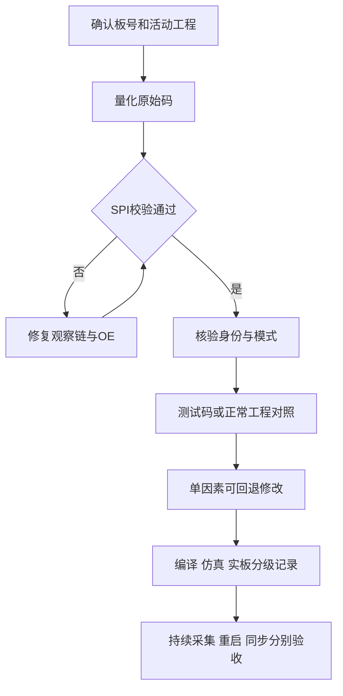

# 证据关卡与判据

对应 SKILL.md 线路 A 的 A0–A6。每关都有"通过判据"和"不能证明什么"，未过闸不要进下一关。

## G0 上下文

记录板号、芯片型号与修订版、实物改动、输入通道/幅度/宽度/周期、未用通道状态、已有测量（时钟、电压）、实际 XPR 与 bit/ltx、CSV 抓取时钟。区分用户确认与工具实测。补问只限影响下一步的缺失项——把整份需求表问一遍只会拖住排查。

## G1 原始异常

先看 ADC 附近原始码，不凭能谱双峰猜算法。按 Radix 统计位活动、低 5 位组合、码值步距、满码情况与两个并行样点的顺序。

- "9 个 ADC 码差值""9 位输出""9 位 ENOB"是三种不同表述，不能混说。
- 悬空通道出现满码不直接判故障。
- 内部 Ramp 通过不证明模拟前端及正常模式正确。

**不能证明**：位活动丰富即 ENOB 达标；常量通道的位数结论。

## G2 SPI 可信度

核验 CS、指令帧长、位序、边沿、读阶段 SDIO 高阻释放与顶层 OE 贯通。用手册支持的暂存器做 AB/CD 不同值写读、交叉复读、读后恢复现场。校验失败或全 0/FF 时，先修观察手段，不解释 ID。检查自定义完成标志的实现。

**不能证明**：1024 行锁存值是 1024 次独立读取；静态 CSV 能反映实际 SCLK 频率。

## G3 身份与模式

按具体修订版查 ID 与模式表。核验读取之前是否有旧 bit、预探测或 MCU/Flash 主动写入。软复位按手册等待时间执行，不冒称"冷上电纯只读"。停止写入未公开寄存器是清理动作，不自动证明根因。

数字侧正常而模拟侧异常时，再针对共模、参考、时钟与前端测量；不凭几毫伏的万用表差异锁定电源。

**不能证明**：功能匹配某器件 = 实物来源鉴定；一次 ID 读回 = 器件真伪结论。

## G4 工程对照

从**实际 XPR 引用**找活动源与 IP，不读错备份。逐项比较：

| 层 | 比较项 |
|---|---|
| ADC 写表 | 寄存器条数、顺序、延时表、pair/channel 选择、末索引 |
| 时钟 | LMK 表、SPI 分频、实际时钟频率 |
| 触发 | 复位序列、配置完成、SYSREF 触发点 |
| JESD/PHY | XCI/XCIX 参数、运行期 AXI 配置（ILAS、SYSREF、F/K、lane 掩码、扰码、Subclass） |
| 约束与实现 | XDC 覆盖范围、布线报告 |

注释 `Sysref once` 不是配置语义；满足已有约束不等于未约束输入已被约束。

## G5 单因素闭环

每轮记录：基线、唯一变化、预期、结果、来源、回退。一次只改一项——不同时改 lane、时钟和 ADC 表。恢复后不强制继续改完所有差异。

失败时抓首次失效顺序：GT lock / reset_done → 8b/10b 错误 → 帧错误 → rx_tvalid → SYNC。LMK 锁定不等于 GT 锁定；同时变化不证明 SYNC 驱动了 SYSREF。

## G6 验收

分别登记：波形形态、持续有效/错误计数、长时间采集、重复冷启动；需要时另验多器件同步与确定延迟。用户没定义的时长与次数不能虚构。

## 关卡流程图

## 关卡的作用

关卡的顺序本身是经验：把"观察手段是否可信"放在"器件是否正常"前面，是因为历史上最贵的一次误判就发生在回读本身失效时——全 0/FF 被当成器件异常，而真实原因是读阶段 SDIO 没释放。后续所有关卡都建立在"观察可信"之上。
