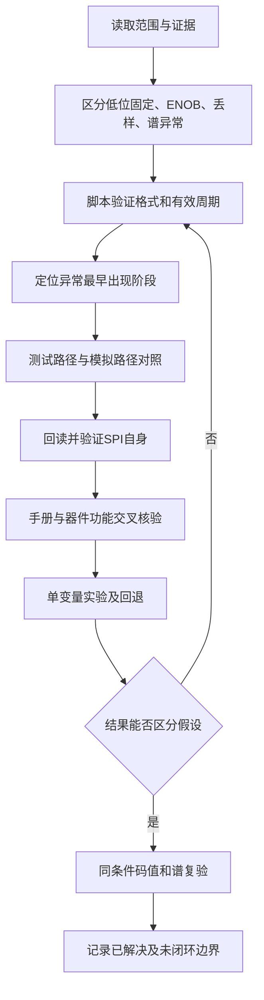

# 实验契约

每项实验先写清：板卡/工程/bit/ltx、输入与时钟、探针格式与有效条件、唯一改动、预期分支、实际结果、回退方式。缺任何一项，这轮实验就不能算数。

## 一、SPI 回读

- 源码里 `HALF_CYCLES=500` 不证明板上已跑 100 kHz。测 SCLK 边沿周期或用外部仪器；scratch 的 A5/5A 校验通过后恢复原值。
- 原始串行位、第二采样时刻与主机结果交叉核验；内部监视仍共享 SDIO 输入，**不是**独立仪器。
- 1024 行锁存值不代表 1024 次 SPI 读取。
- 1024 深度、100 MHz 的 ILA 只有 10.24 μs，装不下 100 kHz 的 24 位 240 μs 帧。用锁存观测、加深度或存储限定，不要让用户去抢一个物理上装不下的完整帧。

## 二、冷上电只读

- 先确认是否还有旧 Flash 程序、MCU 或其他主机会写 ADC。本例用户确认仅 JTAG 下载。
- 整板断电、确认 ADC 各轨放电后，上电直接下载只读版，不先跑旧 demo。**FPGA 复位不是 ADC 冷复位。**
- 任何写入之前只读 0x0004、0x0200，各重复一次，然后静默；不写软复位、pair 或 scratch。默认值核验不能标成"分别读取 AB/CD"；需要分 pair 时，先保存纯只读证据，再另起阶段。
- `assets/` 参考 RTL 在 LMK 完成后等待 20 ms（本例 100 MHz），全程只有四帧读，`SPI_config_OK` 恒 0，不进行正常采样。依赖顶层 IOBUF 与 `ila_adc_spi`：probe 0–11 为 8 位、12 为 2 位、13/14 为 8 位、15 为 6 位。其他平台先适配再谈结论。

## 三、模式修复

- 先只改 0x0200，固定输入，比较实际回读、码值与能谱。**不要**把 demo 的完整 Configure 直接覆盖业务工程：接口、IOBUF 与初始化流程不同。
- 增加写入时同步更新末索引、条目数、延时表与 pair/channel 选择（本例 `Number_regs` 是最后索引）。
- 独立实数脉冲应核对 VDR 实数模式、频带及全幅度/计数率范围下的降位状态。
- 插控制位前同步核对 N、N′、CS、接收端检查与原始布局；**不得把状态位误送进基线或能量算术**。

## 四、残余能谱

- 取完整累计谱，区分单 bin 计数、区域积分与峰顶截断。
- 事件间峰值是锁存值，用 `class_valid` 计数，不能按数千行重复值统计粒子数。
- 结果出现在脉冲之后，留足预触发。
- 本例 bin = floor(peak/8)，2172–2173 道对应 43E0 ≤ peak < 43F0，同时限定 `class_valid` 与 gamma 类型；旧 `small_hit` 的 4300–435F 对应 2144–2155 道，抓不到新凸起。改变合并道数或增益后须重新推导阈值。

## 五、工作流

该流程是可复用设计。实际执行不必机械走满每步，但跳过任何一步都要说明理由——尤其是"跳过 C（验证格式）直接进 E"这种，历史上对应的就是误判。
