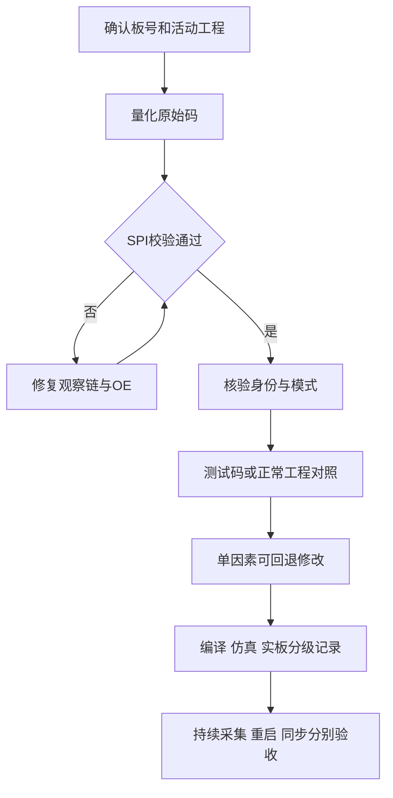
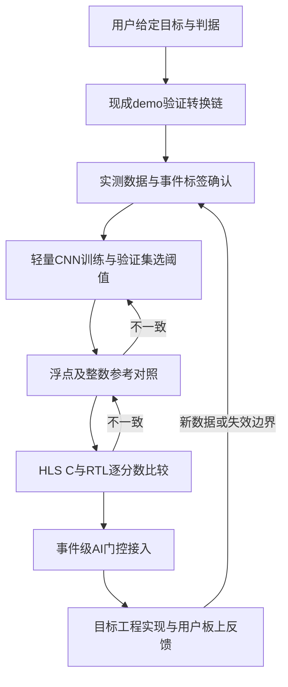

# 大模型协作与技能包：大模型协作记录

本文件对应四项内容：**提示词**（第二节、第五节）、**模型回答**（同段落中的动作摘要）、**自我纠错轨迹**（第四节、第五节各段"纠正"）、**智能体工作流设计**（第六节）。

本文是**结构化摘录**，不是逐字聊天导出。带引号者为用户提示词原话节选；模型回答以工程文件、日志与结果为依据作摘要；只记录可观察的建议、操作与修正，不推测模型内部思维过程，不补写未发生的多智能体自主协作。

## 一、任务与角色分工

本包包含两条任务线，来自同一套采集链的前后两段：

| | 线路 A：ADC 位宽与能谱双峰 | 线路 B：脉冲波形 AI 部署 |
|---|---|---|
| 触发问题 | 单能量源出现双峰；14 位采样字低 5 位恒零；两板反复掉 JESD 同步 | 把实测脉冲波形分类模型接进 FPGA，实现在线候选甄别 |
| 用户承担 | 提供硬件资料、源码、CSV 与 ILA 采集；执行测量、改焊、换件、下载，并反馈实板结果 | 提供实测数据、人工判据；确认标签边界；执行实测并反馈 |
| 助手承担 | 文件与数据分析、官方资料核验、活动工程对照、补丁与数字仿真 | 数据整理与标签、训练与定点、HLS/RTL 对照、事件级接入 |
| 工具承担 | 文件读取、位模式统计、手册检索、Vivado 协议仿真 | 训练框架、整数参考、HLS 转换、xsim/Vivado 实现 |

两条线共同遵守的分工边界：**板上结果不是助手独立测得**，一律标注为"用户报告"；**工具仿真不等于实板运行**；**模型建议不等于用户已执行**。

## 二、线路 A：提示词—动作—修正

| 阶段 | 用户提示词（原话节选） | 模型回答与动作 | 证据与修正 |
|---|---|---|---|
| 独立诊断 | "不要依赖对话中ai建议，你自己独立想想问题应该在哪" | 从原始码、数据链、配置与硬件重建假设，不沿用既有 AI 结论 | 后续以 CSV 与手册取代建议的权威性 |
| 明确症状 | "原始 ADC 码的低 5 位固定为 0（或固定值）" | 把"14 位变 9 位"转成可统计的位模式问题 | 不再与 ENOB、时间丢样混用 |
| 收窄范围 | "现在不用管v10,就看demo" | 优先定位 demo 及 ADC 侧，不扩展到业务工程 | 技能保留用户给定范围，不默认重构全部工程 |
| 排除配置假设 | 用户报告去掉 13 条未公开寄存器写入后仍全 0 | 比较原始数据、Ramp 与 SPI 回读 | 不支持"13 条即根因"，也不证明整个初始化正确 |
| 型号矛盾 | "我的芯片就是9694啊"，并附照片 | 指出 ID DC 与 AD6684 一致，但修正为"丝印/BOM 与读回矛盾，先验证读取链" | 不凭单个 ID 作实物型号或改标结论 |
| 供电异议 | "不能就这样怀疑供电" | 收回把约 0.945 V 边界读数放得过高的优先级，结合仪表误差与两板对照 | 电源保留为可测假设，不要求先改硬件 |
| 推进顺序 | "先把fpga所以嫌疑排除，再从硬件排查" | 按模式回读、SPI 可靠性、功能差异逐项推进 | 不把一项检查通过表述为"FPGA 全部排除" |
| 回读与降速 | 提供 read2/read3 | 读回 mode=00、N=0D、N′=2F、ID=DC；降速后锁存值相同 | 承认静态 CSV 不能测频率，准备原始位序观察 |
| 关键转折 | "assign write_reg[38] = 24'h020008; 按照6684这样配置了，有14位了" | 查 AD9694/AD6684 官方手册，复核 CSV 低位活动 | 功能模式差异成为有力解释；纠正"有 14 位"≠ ENOB=14 |
| 默认值核验 | "帮我改好，我要实锤"；随后确认仅 JTAG 下载 | 生成上电前置只读版，不写软复位/索引/初始化，仅读两地址各一次 | 协议仿真有记录；实板冷读结果未见回传，标记待验证 |
| 能谱复验 | "我测了20分钟吧，还是有个小的……好多了" | 统计 1.csv/2.csv 并看截图：主异常改善，残余事件未捕获 | 发现旧捕获能区不覆盖新凸起，更新捕获方法 |

## 三、线路 A 的两个独立闭环

两条闭环证据链不同，**不能合并成"9694 都写 08"**，也不能把所有现象归为同一根因：

- **闭环 1（身份/模式）**：标称 AD9694 的板子读到 ID=DC，按 AD6684 的模式 08 配置后低位锁零改善 → 支持"内部处理模式不符"的解释。没有供应链鉴定，不等于实物真伪结论。
- **闭环 2（同步稳定性）**：换回 ID=DB 的器件按 00 工作，demo 正常而业务工程失稳；仅把 FPGA JESD AXI 0x010 bit0 由 1 改 0 后用户确认恢复 → 该修改足以消除当时失稳，但 SYSREF 的物理根源未证明。

## 四、线路 A：自我纠错轨迹

| 过早或不完整的表述 | 新证据 | 修正后的表述 | 提炼的规则 |
|---|---|---|---|
| ID=DC 就把实物认作 AD6684 | 丝印与 BOM 标 AD9694、另有读取链疑点 | 功能行为匹配与实物鉴定分开 | 至少交叉核验 ID、默认模式、行为与读取可靠性 |
| 边界电压是首要根因 | 万用表误差未知，两板电压高低与 JESD 表现不一致 | 不能由几毫伏单点偏差裁定供电 | 用反证更新优先级，不强迫用户先改板 |
| Ramp 正常意味着整条链路正常 | 只验证 A 通道，注入点可能不同 | 结论限定到通道、模式与注入路径 | 测试路径不能替代模拟路径验收 |
| 源码参数 500 即证明板上 100 kHz | CSV 只是最终锁存值 | 须观测 SCLK 周期或用仪器核验 | 源码、位流、硬件运行证据分层 |
| read2/read3 内容相同说明旧数据被复用 | 静态值与样点索引可能本来就完全一致 | 先解释数据生成机制，再判断证据意义 | 不凭哈希怀疑用户采集 |
| N 写 14 就是 14 位精度 | mode=00 下低位仍清零 | JESD N 不是前级有效信息位的保证 | 分开转换、内部处理、传输字与算法数据 |
| 改 08 已稳定 14 位 | VDR 受频谱条件约束可降位，默认仍为复数模式 | 低位恢复已证实，全条件精度待状态监测 | 行为恢复不升级为超出证据的性能承诺 |
| 谱上 2 个计数就是次峰 | 峰顶被截断，稀有波形未捕获 | 先称"零星计数/残余凸起"，取完整谱与对应事件 | 单 bin 占比不等于峰面积，不编造根因 |

## 五、线路 B：提示词—动作—修正

### 1. 先跑现成 demo，再适配任务

> 用户原话："我们先一步步来吗，先网上搜demo，github，先把demo跑通，再改demo，符合我们的需求"
>
> 用户原话："等一下你找的 这个是学生项目，感觉都没人用，没有更好的了吗"

动作：把第一阶段目标限定为验证 FPGA 推理工具链，转向 hls4ml 及其官方示例模型，用官方预训练模型做转换、定点 C 仿真、C/RTL 联合仿真与独立内核实现，而不是把示例权重用于脉冲甄别。

证据：官方 demo 128 组输入、640 个输出，浮点与定点分类索引 128/128 一致，RTL 与 C 输出逐项一致；独立内核 200 MHz 实现通过。

纠正："demo 成功"只证明转换与推理路径可用，不能写成氚水识别准确率 100%。模型来源、任务定义与性能证据必须分开。

### 2. 从汇总特征转向保留时序结构

> 用户原话："用现有训练模型或一个通用小网络结构，完成257点波形的软件及定点验证；核对类别、预处理和标签，不重新发明网络。"

动作：先验证特征型小网络的可实现性，再针对多峰困难波形比较标准小型一维 CNN，最终采用三层卷积 + 池化 + 全局平均 + 单 logit，保留脉冲簇的时间结构。

证据：5/9/15 卷积核、8/8/8 通道，共 1729 个训练参数；独立前向实现与训练框架对照，随后完成定点与 HLS/RTL 推理验证。

纠正：硬件开销小与分类效果好必须分别验证；短感受野或少量汇总特征未必保留人工判断依赖的簇结构；扩大网络也应由困难样本比较支持。

### 3. 修正 AI 观察窗的物理时间

> 用户原话："好的，就这样做把观察窗恢复到2.56 μs，并且这段数据处理成257点，对应10 ns间隔。然后我去实测"

动作：把原始 1281 点 / 2 ns 的 2.56 μs 帧转换为 257 点 / 10 ns 输入，明确中心五点整数均值、步长 5 与端点复制；训练与 RTL 使用同一预处理约定。

失败观察与纠正：同样 257 点在 2 ns 间隔下首末跨度仅 0.512 μs，不能等同 2.56 μs 观察窗；只改显示时间轴不会恢复模型实际看到的脉冲簇。修正的是进入模型的数据覆盖时间。

### 4. 用新实测数据重建候选标签

> 用户原话："我们人工判断氚水标准是在整个2.56us的观察窗内，大于等于4个脉冲，就认为是氚水，但是不能冲顶，冲顶就认为是宇宙射线。"
>
> 模型追问："至少4个脉冲"中，小峰最低多高才算一个？
>
> 用户回答："超过设定阈值就算一个，"
>
> 模型追问：第三峰后的回摆又过了一次阈值。这个回摆你会算"第4个独立脉冲"吗？
>
> 用户回答："只要再次过阈就算"

动作：把规则落实为独立连续过阈区段计数，回落后再次过阈计新脉冲；不追加用户未要求的最小间隔或脉宽；任一原始点达到上满码时拒绝。使用两批新实测数据共 25755 条，不按采集文件来源直接分配正负标签。

纠正："氚水样品中采到"不等于"每条都是氚事件"；本底文件中符合规则的事件同样保留为候选。当前标签是用户波形规则的代理，冲顶表示电子学饱和，其来源不能仅由波形独立确认为某类粒子。

### 5. 从浮点效果推进到可复现整数推理

> 用户需求摘要：以实测数据训练能够在 FPGA 中运行的在线候选甄别模型。

动作：复用已验证 CNN 结构，按时间分块与空档划分数据，用验证集选择轮次与阈值；BN 折入卷积，权重 12 位 Q8、激活 24 位 Q14，导出默认阈值 4043，判决为整数得分严格大于阈值。

证据：两种浮点实现 128 组最大绝对误差约 4.48×10⁻⁶；两个独立整数参考在探针上逐分数精确一致；新权重 128 组 HLS C 与 RTL 分数精确匹配整数参考；3864 条留出数据上定点与浮点判决一致率 99.77%。

纠正：调阈值不能代替加载新权重；浮点性能不能直接当作定点 RTL 性能；输出是 logit 分数，不标注为概率。

### 6. 对原始冲顶增加确定性否决

观察：部分帧只有短暂原始冲顶，五点均值可能稀释其幅度；CNN 单独判决仍放行了部分饱和帧。

动作：在均值与降采样前扫描 1281 点原始帧，任一值 ≥ 65532 置冲顶标志；AI 判决取"CNN 过阈且原始帧未冲顶"，再与原有候选许可组合；分数与否决原因分开保留。

证据：留出集 CNN 单独负类误放 90 条，加否决后为 10 条，正类通过 977 条不变；24 帧 RTL 测试覆盖单点冲顶、不同采样相位、首末点与真实留出波形；事件级仿真确认拒绝事件不进入受门控的输出与统计。

纠正：不能指望网络重建降采样已丢失的信息；组合判决的改善必须明确包含硬否决的贡献。

### 7. 完成运行闭环

> 用户最终反馈："不用检查了，我已经实测了，整个系统跑通了"

动作：在目标实现工具中验证生成 RTL 与权重 ROM，完成事件关联、复位、背压与最终判决链仿真，以及目标工程综合、实现与时序。

可作出的结论：从软件训练、定点推理、HLS/RTL 到工程运行的链路已闭环，板上结果由用户反馈确认；该反馈不提供独立逐事件物理真值或新增分类统计，不改写为额外准确率。

## 六、智能体工作流设计

两条线采用同一种协作形态：**用户给定目标与判据 → 单个编码助手调用工具执行 → 结果反馈 → 修正 → 收敛**。大模型负责拆解任务、生成脚本、调用训练与仿真工具、解释不一致并整理证据；训练、整数计算与 RTL 仿真由相应软件执行。实际部署到 FPGA 的是轻量 CNN，不是在 FPGA 内运行对话大模型。不把过程表述成未经记录的多智能体自主协作。

### 线路 A 工作流

### 线路 B 工作流

### 两线之间的依赖

线路 A 的产出（可信的原始码、明确的位宽与采样间隔、可复现的触发条件）是线路 B 的输入契约。若 A 未收敛就开始 B，模型学到的可能是错误位宽或错误物理窗口的波形；若 B 的指标异常而 A 的结论仍带"待验证"标记，应先回到 A。

## 七、可复用提示词模板

以下为事后提炼的新模板，不是历史原话。

**线路 A**

1. 初始分析："使用 $fpga-adc-pulse-ai。现象是[低位恒定/能谱双峰/掉同步]。只分析[板卡及工程]。先用原始 CSV 验证位宽、进制与有效周期，区分事实、假设和待测项。已有 AI 建议只作线索；下一步选择能区分主要假设的最小实验。"
2. 证据冲突："现有[丝印/BOM/ID/默认模式/原始码]互相矛盾。请列出每项证据支持与不能支持的结论，先检查回读链。新结果若推翻先前判断，请明确修正，不要求继续完成已无必要的旧计划。"
3. 实验交付："请提供可回退的诊断方案，说明改动、依赖、位流/探针匹配、触发、期望分支及验收边界。若测默认寄存器，保证在 ADC 任何写入前读取，并区分 RTL 仿真、硬件执行与用户报告。"
4. 成效复核："对比改动前后的原始码与累计谱。逐项说明低位固定、主双峰、有效精度与稀有事件各解决到什么程度。不要凭一次短 ILA 抓取宣布长期验收通过。"

**线路 B**

5. 工具链阶段："先用可追溯的通用 demo 跑通浮点、定点 C 和 RTL，逐项比较输出；把工具链一致性与目标任务准确率分开。"
6. 数据阶段："先确认窗口物理时间和逐事件标签。请列出会改变标签的模糊边界，用具体样本向我核实；不要把测量文件名当作事件类别。"
7. 量化阶段："明确位宽、舍入、端点和溢出行为，建立独立整数参考，再用同一输入逐分数验证 HLS 与 RTL。"
8. 接入阶段："以完整事件为单位锁存输入、阈值和编号；只有最终判决通过才放行，覆盖背压、复位及原始饱和边界。"
